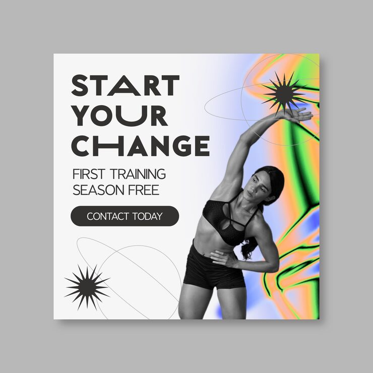

# 'Start Your Change' gym banner with a greyscale stretching photo and a holographic starburst accent

**Discipline:** print-social · **Design type:** Social ad · **Design style:** Retro & Pixel
**Tags:** gym, fitness, holographic, starburst, greyscale, banner

## What it is
A grey-bordered square banner with a bold condensed 'START YOUR CHANGE' headline, 'First Training Season Free' subline, a black 'Contact Today' pill button, thin orbit-line graphics with starburst accents, and a greyscale photo of a woman stretching against a holographic rainbow-gradient backdrop.

## What it means
Bold and current; the holographic gradient behind a greyscale athlete makes a standard gym offer feel fresh and premium.

## Techniques
- Contrast a greyscale subject against a vivid holographic backdrop.
- Add thin orbit-line graphics with starburst accents for energy.
- Keep the CTA in a simple solid pill button.

## Best for
- Gym and fitness marketing
- Holographic trend branding
- Offer-led social banners

## Vocabulary
- **Holographic gradient** — A shifting rainbow colour effect mimicking foil or prism material.
- **Starburst accent** — A small spiky shape used for emphasis.
