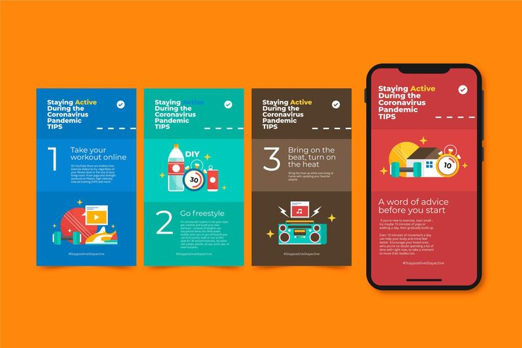

# 'Staying Active During the Coronavirus Pandemic' numbered tip carousel in blue, teal and brown cards

**Discipline:** print-social · **Design type:** Social carousel · **Design style:** Playful & Illustrated
**Tags:** health-tips, carousel, numbered, flat-illustration, fitness, instagram

## What it is
A four-slide carousel (blue, teal, brown, red) each headed 'Staying Active During the Coronavirus Pandemic TIPS' with a checkmark, a large numeral (1, 2, 3) and a flat illustration (home workout on a laptop, a water bottle and timer, a boombox and playlist), shown mocked up on a phone for the closing card.

## What it means
Reassuring and practical; consistent numbering across colour-coded cards makes health advice easy to follow in order.

## Techniques
- Number tips sequentially across a carousel.
- Colour-code each slide while keeping layout identical.
- Close the set with a phone mockup showing the final message.

## Best for
- Health and wellness campaigns
- Numbered tip carousels
- Public awareness content

## Vocabulary
- **Tip carousel** — A sequence of slides each presenting one piece of advice.
- **Checkmark motif** — A tick icon used to signal validated or trustworthy content.
