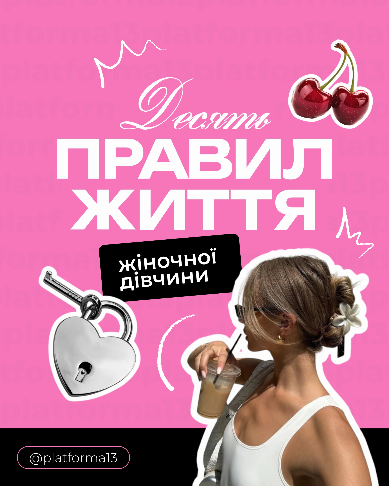

# Hot-pink sticker-collage carousel cover

**Discipline:** print-social ·  · **Design style:** Playful & Illustrated
**Tags:** social-media, carousel, sticker-collage, hot-pink, cutout, script-and-grotesk, cyrillic, portrait-4x5, playful

## What it is
A 4:5 portrait Instagram carousel cover on flat hot pink. A huge extended white sans headline stacks over a delicate white script word. Cut-out photos with thick white outlines (cherries, a heart padlock, a woman sipping iced coffee) are scattered like stickers, with white hand-drawn squiggles and a tilted black label. A black footer band holds an outlined handle pill. A faint tiled repeat of the account name sits behind everything.

## What it means
It is loud, flirty and instantly scroll-stopping, with the feel of a teen's scrapbook or a magazine cover. The pink is bold, the black adds punch, and the sticker objects add personality and a little wit. The mix of elegant script and heavy sans says 'soft but confident'.

## Techniques
- Pair a delicate script word with a massive extended sans headline for strong contrast in mood and weight.
- Cut out photos and objects and give them a thick white outline so they read as stickers on the flat colour.
- Scatter the stickers unevenly and overlap the headline slightly, so the composition feels hand-made and lively.
- Add hand-drawn white squiggles and crowns as gestural accents that echo the script type.
- Tilt one black label a few degrees to break the grid and hold the secondary line of text.
- Use a single saturated background with black and white only, letting the photos supply the extra colour.
- Repeat the account name as a very faint tiled pattern behind everything for branding without clutter.
- Anchor the layout with a black footer band and an outlined pill holding the handle.

## Best for
- Instagram and TikTok carousels, especially lifestyle, beauty and fashion content
- Listicle and 'rules / tips / steps' posts
- Youth-oriented or feminine-leaning brands and creators
- Posters, event flyers and zine covers that want a sticker-scrapbook feel

## Vocabulary
- **Sticker cutout** — An image with the background removed and a thick contrasting outline, so it looks like a die-cut sticker.
- **Extended sans** — A grotesque typeface with wide letterforms, giving a bold, modern feel at large sizes.
- **Script contrast** — Pairing a flowing calligraphic word with a heavy sans to create hierarchy and personality.
- **Carousel cover** — The first slide of a swipeable social post, designed to stop the scroll and promise what follows.
- **Doodle accent** — Hand-drawn lines or shapes added over a layout to make it feel human and informal.
- **Ghost pattern** — A very low-contrast repeated text or shape in the background, adding texture without competing.
