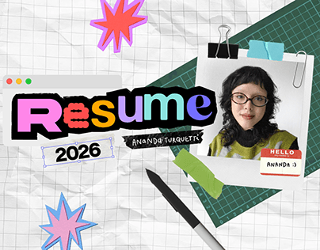

# Resume cover with letter-mixed title, paper clips and cutting mat

**Discipline:** print-social · **Design type:** Presentation slides
**Tags:** resume, collage, sticker, paper, cutting-mat, mixed-lettering, pink, green

## What it is
A crumpled graph-paper background with a dark green cutting mat corner. A polaroid-style photo is clipped with bulldog and paper clips and has a 'HELLO my name is' sticker. A browser-window bar holds a title 'Resume' in mixed coloured letters over a cut-out ransom-note style, with '2026' in an outlined tag and a stylus at the bottom.

## What it means
Playful and handmade; designer's desk objects give personality to a CV.

## Techniques
- Build a collage of desk objects (clips, mat, stylus) as the frame.
- Mix letter styles and colours in one word like a ransom note.
- Use a fake app window bar for the title.
- Add starburst stickers in bright pinks and blues.

## Best for
- Creative resumes and about-me slides
- Portfolio covers
- Personal-brand decks

## Vocabulary
- **Ransom-note lettering** — Each letter in a different style and colour.
- **Desk collage** — A layout made from office and studio objects.
- **Name sticker** — A 'Hello my name is' label.
- **Cutting-mat texture** — A green grid mat used as a background.
