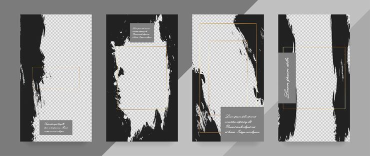

# Black brush-stroke Instagram story template set

**Discipline:** print-social · **Design type:** Story set · **Design style:** Editorial
**Tags:** instagram stories, brush stroke, black white, photo frame, editorial, gold

## What it is
Four vertical story templates alternating black and white backgrounds, each using an irregular black paint-brush swipe as a placeholder photo frame with a thin gold-bordered caption box.

## What it means
Swapping which half is black vs white across the set keeps a minimal two-tone system from feeling monotonous over multiple stories.

## Techniques
- alternate a two-tone background split across a template set for variety within consistency
- use a raw brush-stroke mask as the image container instead of a clean rectangle
- add one thin gold-line accent box to elevate an otherwise black-and-white palette

## Best for
- personal blog or lifestyle story highlights
- minimalist editorial brand kits
- fashion/beauty story templates

## Vocabulary
- **mask** — a shape used to control which part of an underlying image or layer is visible
