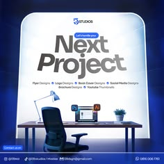

# Design studio services ad with desk scene and giant headline

**Discipline:** print-social ·  · **Design style:** Editorial
**Tags:** ad, services, blue, desk-scene, sans-serif, contact-info, square-format

## What it is
A square ad on blue: a glowing white arch shape frames a desk with a monitor and chair, with a huge 'Next Project' headline in black and grey, a list of services in small text and contact icons at the bottom.

## What it means
Professional and approachable; the desk scene tells people this is where work gets done.

## Techniques
- Use a lit stage shape (arch) behind a scene to focus the eye on the headline.
- Pair a huge two-line headline with a small services list for scanning.
- Group contact handles in a row at the base.
- Keep the palette to brand blue, white and black.

## Best for
- Freelance and studio service promos
- Agency announcements
- Social ads listing several services

## Vocabulary
- **Stage shape** — A bright geometric form behind the subject as a spotlight.
- **Services list** — A compact line of offerings under a headline.
- **Contact row** — Icons and handles arranged in a strip.
- **Headline scale** — Making the main phrase dominate the layout.
