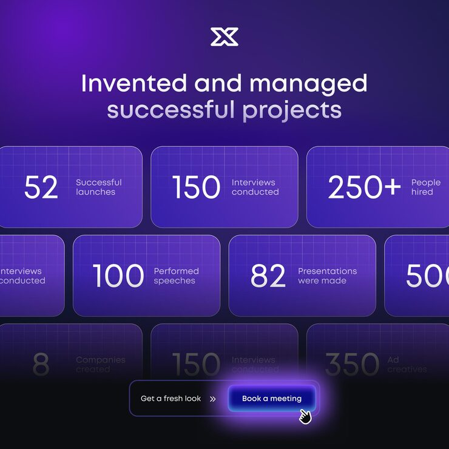

# 'Invented and managed successful projects' stats post with offset rows of violet glass tiles

**Discipline:** print-social · **Design type:** Social educational post · **Design style:** Glassmorphism
**Tags:** stats, agency, violet, glass, numbers, cta

## What it is
A square violet post with a white X logo, a two-tone headline, and three offset rows of frosted violet glass tiles with fine grids showing big numbers and labels (52 Successful launches, 150 Interviews conducted, 250+ People hired), fading toward the bottom, plus a split 'Book a meeting' CTA.

## What it means
Impressive and tactile; staggered stats feel like an endless wall of achievements.

## Techniques
- Offset rows of stat tiles like bricks.
- Fade lower rows to suggest more.
- Put a fine grid inside each glass tile.
- Pair big numerals with small labels.

## Best for
- Agency credentials
- Portfolio stats
- Social proof posts

## Vocabulary
- **Stat tile** — A card showing a number and label.
- **Brick layout** — Rows offset like bricks.
