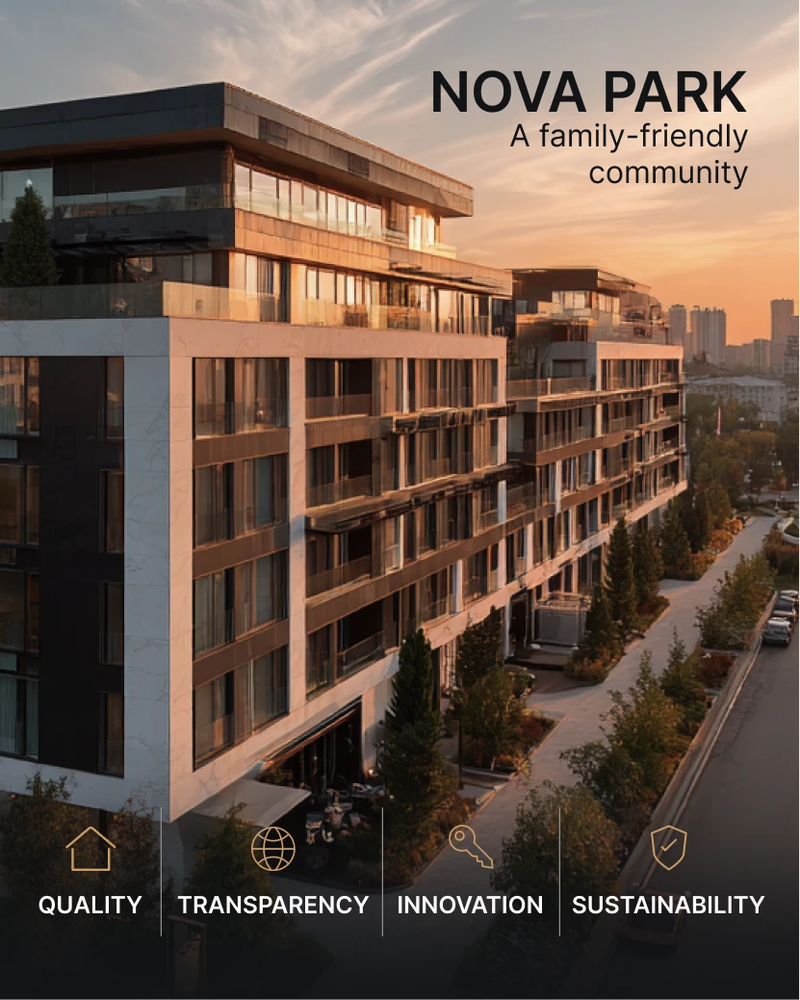

# Sunset photo of a marble-and-glass residence with a bold caps title top right and four value icons in a dark fade

**Discipline:** print-social ·  · **Design style:** Photographic & Cinematic
**Tags:** real-estate, sunset, photo, white-icons, gold-icons, dark-fade, portrait, values

## What it is
A portrait photo of a modern white and bronze apartment block at golden hour with 'NOVA PARK' in bold black caps and 'A family-friendly community' at the top right, fading into black at the bottom where four gold line icons (house, globe, key, shield) sit above white caps labels Quality, Transparency, Innovation and Sustainability separated by hairlines.

## What it means
Warm and credible; the golden hour photo sells and the icon row states the promise.

## Techniques
- Set dark title text in the bright sky.
- Fade the bottom into black.
- Use four gold line icons with hairlines.
- Keep labels in white caps.

## Best for
- Property developer ads
- Values rows
- Sunset photography posts

## Vocabulary
- **Sky title** — A title placed in the sky area.
- **Bottom fade** — A gradient darkening the lower edge.
- **Gold line icon** — A thin outline icon in gold.
- **Values row** — A row of principles with icons.
