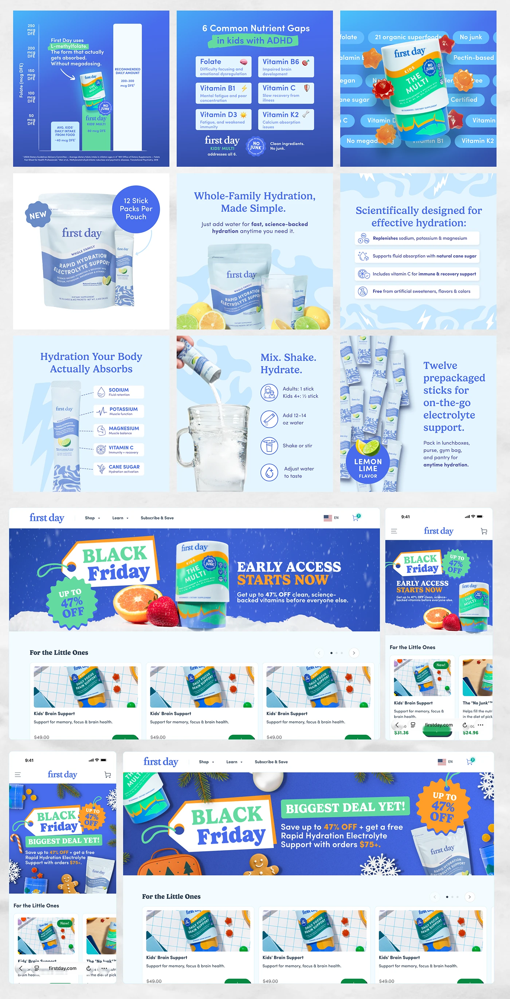

# Blue vitamin infographics, hydration pouch listing images and Black Friday banners with hang tags

**Discipline:** print-social ·  · **Design style:** Dark & Neon
**Tags:** e-commerce, infographic, royal-blue, hydration, black-friday, hang-tag, banners, listing-images

## What it is
A tall sheet with nine square infographic cards in royal and pale blue (nutrient chart, gap grid, floating gummies, pouch and stick packs, ingredient callouts, how-to steps), then desktop and mobile shop pages with 'BLACK Friday' hang-tags, 47% badges, snowy hero photos and product rows.

## What it means
Clear and trustworthy; consistent blue and simple icons make science approachable.

## Techniques
- Explain benefits with callouts pointing at the pack.
- Use icon lists for steps and ingredients.
- Frame sale banners with a hang-tag title.
- Show desktop and mobile of the same promo.

## Best for
- Supplement e-commerce listing images
- Seasonal sale banner systems
- Ingredient and how-to infographics

## Vocabulary
- **Ingredient callout** — A label pointing at a product feature.
- **Hang-tag title** — A title in a price-tag shape.
- **Listing infographic** — An image in an e-commerce product gallery explaining features.
- **Promo badge** — A scalloped badge stating a discount.
