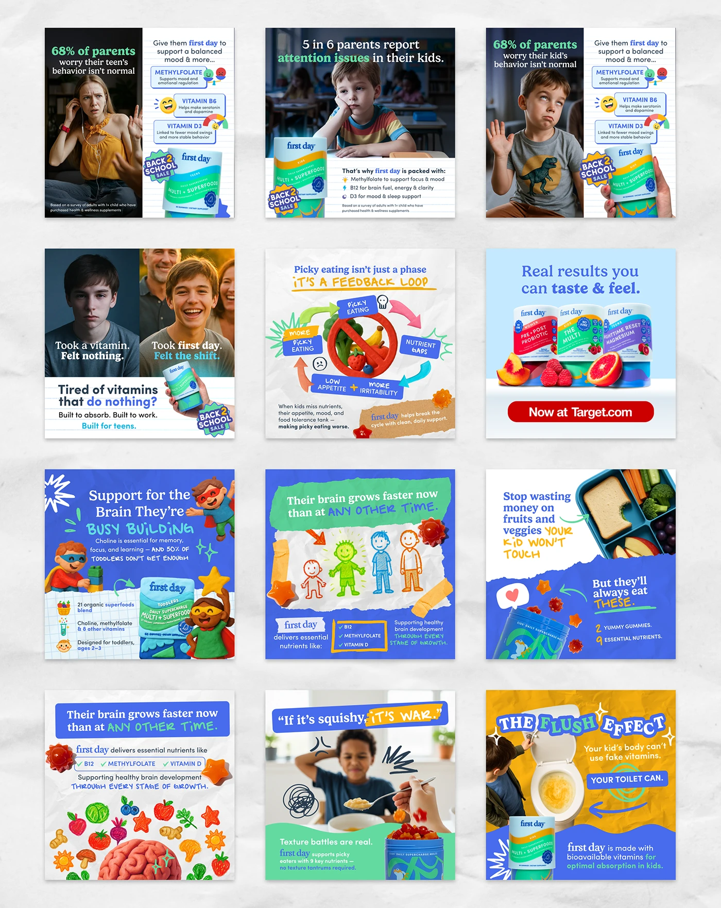

# Twelve kids-vitamin ads mixing emotional photos, crayon doodles, torn paper and product tubs

**Discipline:** print-social ·  · **Design style:** Playful & Illustrated
**Tags:** ads, supplements, royal-blue, crayon, torn-paper, stats, photography, parenting

## What it is
A 3x4 grid of square ads on crumpled paper. They combine photos of frustrated kids and teens with white fact panels and sticker badges, kid-drawn crayon diagrams and superheroes, torn green and blue paper strips, fruit and brain illustrations and product tubs on royal blue.

## What it means
Empathetic and playful; crayon doodles turn nutrition claims into child-friendly stories.

## Techniques
- Mix emotional photos with childlike crayon drawings.
- Use torn paper and tape strips as headline bars.
- Put stat lines in white panels beside the photo.
- Use royal blue as the anchor colour.
- Add round 'Back to school' badges.

## Best for
- Parenting and child-nutrition ads
- Paid social ad sets with variety
- Educational health claims

## Vocabulary
- **Crayon doodle** — A drawing that imitates child crayon art.
- **Torn strip** — A ragged paper band holding text.
- **Fact panel** — A white block with a claim and checkmarks.
- **Emotion hook** — A photo showing a feeling that sparks attention.
