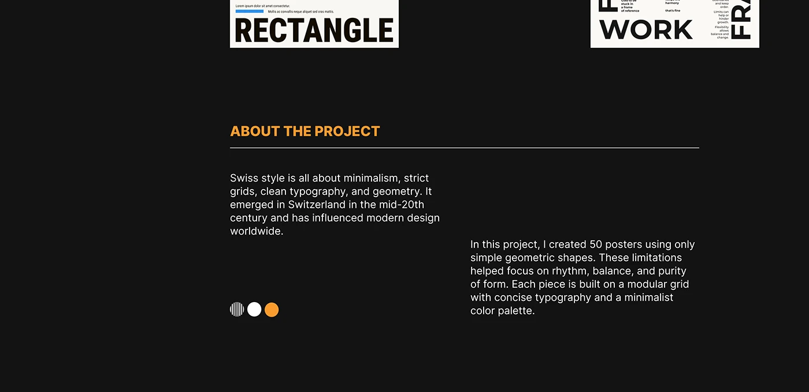

# About-the-project text slide on black with orange heading and three-dot key

**Discipline:** print-social · **Design type:** Presentation slides
**Tags:** case-study, black, orange, white-text, minimal, poster-project, swiss-style, dots

## What it is
A near-black slide with cropped poster edges at the top, an orange uppercase 'ABOUT THE PROJECT' heading over a white rule, two staggered columns of white body text about Swiss style and a 50-poster set, and three small circles (striped, white, orange) at the lower left.

## What it means
Quiet and confident; strictly limited colours echo the constraints described in the text.

## Techniques
- Stagger two text columns at different heights.
- Use one orange for the heading and a swatch dot.
- Show a tiny palette key of circles.
- Crop poster edges into the frame for context.

## Best for
- Project description slides
- Constraint-driven design case studies
- Dark minimal presentations

## Vocabulary
- **Staggered columns** — Text blocks offset vertically.
- **Palette dots** — Small circles showing the colours used.
- **Heading rule** — A thin line under a heading.
- **Constraint statement** — A description of self-imposed limits.
