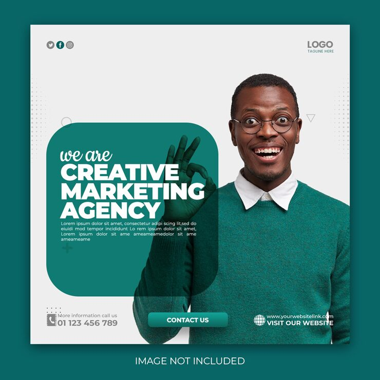

# Teal 'We are Creative Marketing Agency' post with a translucent rounded panel and an excited man giving OK

**Discipline:** print-social · **Design type:** Social ad · **Design style:** Corporate & Clean-Tech
**Tags:** agency, teal, translucent, portrait, ad, corporate

## What it is
A square light grey post with an excited man in glasses and a teal sweater making an OK sign, a translucent teal rounded-square panel overlapping his hand with script 'we are' and bold white 'CREATIVE MARKETING AGENCY', a teal 'Contact us' button, phone and website details.

## What it means
Upbeat and approachable; the translucent panel lets his gesture show through, linking person and message.

## Techniques
- Overlap a translucent panel over the subject's gesture.
- Match the sweater to the brand colour.
- Pair a script lead-in with bold caps.

## Best for
- Marketing agencies
- Friendly corporate ads
- Service promos

## Vocabulary
- **Translucent overlay** — A see-through shape over an image.
- **Gesture** — A hand sign that adds meaning.
