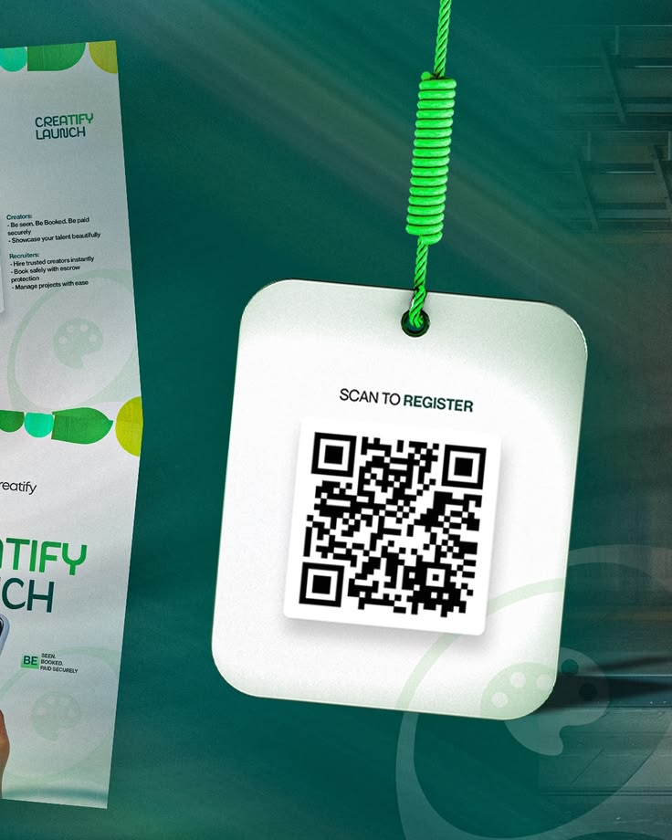

# Hanging QR Tag Launch Visual

**Discipline:** print-social ·  · **Design style:** Minimalist
**Tags:** qr, hanging-tag, teal, green, launch, light-rays, event

## What it is
A teal scene with a white rounded tag hanging from a bright green coiled cord, printing 'Scan to register' over a QR code, with an angled flyer in the corner and light rays.

## What it means
The dangling tag makes a QR call to action feel physical and inviting. Green and teal feel fresh.

## Techniques
- Physical prop (tag on a cord) carrying the call to action
- Bright green cord as the only vivid accent
- Light beams through a teal atmosphere
- Cropped flyer at the edge for context
- Big rounded shape with a tiny label for simplicity

## Best for
- Event registration promos
- Creator and marketplace launches
- QR-driven campaigns

## Vocabulary
- **Call-to-action prop** — A physical-looking object that carries the ask.
- **Light rays** — Diagonal beams of light adding atmosphere.
- **Cropped flyer** — A printed piece partly shown to suggest a wider campaign.
