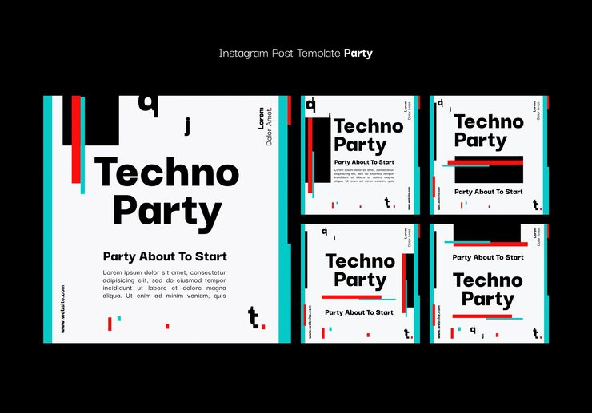

# 'Techno Party' pack in black and white with cyan-red colour blocks and small rotated letter marks

**Discipline:** print-social · **Design type:** Social template pack · **Design style:** Neo-Brutalist
**Tags:** techno, party, black-white, cyan-red, brutalist, instagram

## What it is
Five square posts alternating black and white, each with bold black 'Techno Party' type, thin cyan and red rectangle accents along one edge, small rotated single-letter marks (q, j, t) in corners, and 'Party About To Start' with body copy.

## What it means
Raw and confident; sparse colour blocks and rotated letter marks give a minimal layout underground club credibility.

## Techniques
- Use thin colour-block strokes along one edge only.
- Add small rotated single letters as a cryptic brand detail.
- Alternate black and white backgrounds within one set.

## Best for
- Techno and electronic music events
- Minimal brutalist branding
- Nightlife promotion

## Vocabulary
- **Rotated letter mark** — A single character rotated and placed as a small graphic detail.
- **Colour-block stroke** — A thin bar of colour used as a structural accent.
