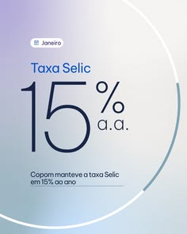

# Financial news post with a huge thin '15%' inside a white ring over a violet and grey gradient

**Discipline:** print-social ·  · **Design style:** Gradient & Aurora
**Tags:** finance, news, stat, thin-type, gradient, ring, minimal, portuguese

## What it is
A square post with a lilac-to-grey blurred gradient, a small dated tag, a title 'Taxa Selic', a giant thin navy '15%' with 'a.a.' and a one-line note, all crossed by a thin white circular arc.

## What it means
Calm and authoritative; the giant light number is the whole message.

## Techniques
- Set a single huge light-weight number.
- Draw a thin white ring crossing the layout.
- Use a soft gradient background.
- Add a small tag and one-line explanation.

## Best for
- Economic and finance news posts
- Stat-led posts
- Minimal data cards

## Vocabulary
- **Hero number** — One giant figure as the main graphic.
- **Thin ring** — A very thin circular line.
- **Date tag** — A small label with the month.
- **Soft gradient** — A gentle blurred blend.
