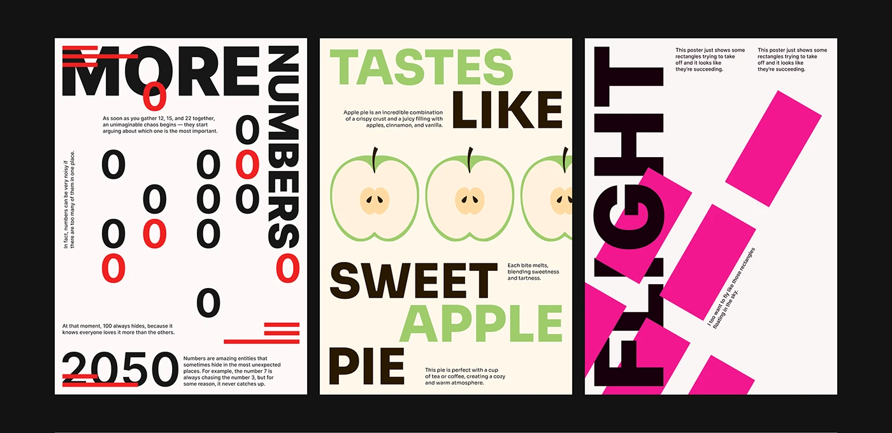

# Three type posters: scattered red zeros, apple halves under stacked words, and a rotated FLIGHT with pink rectangles

**Discipline:** print-social ·  · **Design style:** Playful & Illustrated
**Tags:** posters, typography, red, green, pink, apples, numbers, experimental

## What it is
On black, three posters. One white with 'MORE NUMBERS' and a scatter of black and red zeros and a '2050' with red bars; one cream with 'TASTES LIKE SWEET APPLE PIE' in green and brown stacked around three halved apples; one white with a rotated black 'FLIGHT' and pink rectangles sliding diagonally.

## What it means
Playful and clever; each poster shows what its words say.

## Techniques
- Scatter glyphs to illustrate the word.
- Stack words in alternating colours.
- Rotate type against moving shapes.
- Use tiny body columns as texture.

## Best for
- Typography exercise series
- Word-image posters
- Poster portfolio sets

## Vocabulary
- **Glyph scatter** — Repeated characters spread as a pattern.
- **Colour alternation** — Words in alternating colours.
- **Motion rectangles** — Rectangles implying flight.
- **Word illustration** — Layout that depicts the word.
