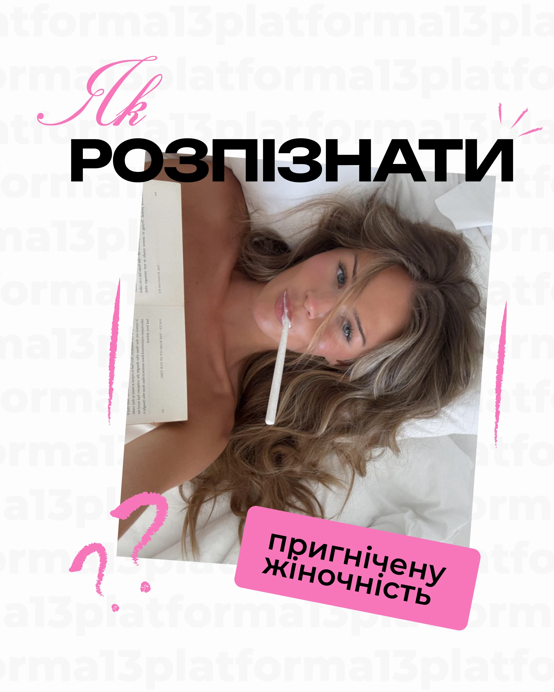

# Tilted photo in a white frame with black extended caps, pink script, pink label and a ghost pattern

**Discipline:** print-social ·  · **Design style:** Playful & Illustrated
**Tags:** cover, pink, black-caps, script, tilted-photo, ghost-pattern, doodles, cyrillic

## What it is
A white portrait with a faint repeated grey brand name pattern, a pink flourished script 'Як', a black extended 'РОЗПІЗНАТИ' overlapping a tilted photo of a woman lying on white sheets with a book and a lolly, a tilted hot-pink label with black rounded text and pink crayon question marks and dashes.

## What it means
Bold, feminine and editorial; script, label and crayon add a diary feel.

## Techniques
- Tilt the photo and overlap it with giant caps.
- Add pink script and a tilted label.
- Draw crayon marks around.
- Keep a faint ghost pattern.

## Best for
- Psychology and lifestyle covers
- Overlapping text-photo layouts
- Pink and black systems

## Vocabulary
- **Tilted photo** — A photo rotated slightly.
- **Crayon mark** — A rough pink stroke.
- **Ghost pattern** — A faint repeated word behind.
- **Overlap headline** — Text covering part of an image.
