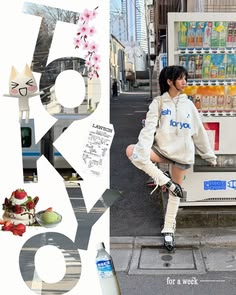

# Tokyo travel post with giant stacked letters, sakura branches and a girl by a vending machine

**Discipline:** print-social ·  · **Design style:** Photographic & Cinematic
**Tags:** travel, collage, tokyo, giant-letters, photo-cutout, sakura, japan, white

## What it is
A white portrait collage where TOKYO is spelled vertically in huge letters filled with street photos, with a sakura branch, a cat mascot sticker, a receipt and a bottle cutout at left and a girl in white by a vending machine at right, plus 'for a week' in tiny text.

## What it means
Vibrant and travel-diary-like; photos inside letters make a place spell itself.

## Techniques
- Fill giant letters with photos of the place.
- Stack the word vertically.
- Add small cutouts (receipt, mascot, flowers).
- Keep the background white.

## Best for
- Travel and city guide posts
- Photo-in-type covers
- Trip diaries

## Vocabulary
- **Image-filled type** — Letters masked with photographs.
- **Vertical stack** — A word arranged top to bottom.
- **Souvenir cutout** — Small objects hinting at a trip.
- **Travel collage** — A layered set of trip images.
