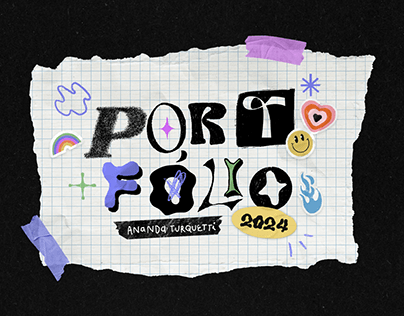

# Portfolio cover on torn grid paper with taped corners and mismatched black-and-white letters

**Discipline:** print-social · **Design type:** Presentation slides
**Tags:** portfolio, cover, torn-paper, grid-paper, tape, stickers, ransom-lettering, black-backdrop

## What it is
A black background with a torn sheet of squared paper held by lilac tape strips. The word PORTFOLIO is built from mismatched letters in black on white and white on black, with small doodle stickers (rainbow, smiley, flame, heart, sparkle) and a yellow '2024' pill and name tape.

## What it means
Handmade and collectable; torn paper and stickers feel like a scrapbook page.

## Techniques
- Set a torn sheet with tape on a black field.
- Mix serif, blackletter and rounded letters in black and white.
- Scatter small doodle stickers around.
- Use a yellow pill for the year.

## Best for
- Creative portfolio covers
- Zine-style decks
- Personal brand intros

## Vocabulary
- **Torn paper edge** — A ragged paper boundary used as a frame.
- **Washi tape** — Translucent coloured tape holding paper down.
- **Mixed lettering** — Letters from different styles in one word.
- **Doodle sticker** — A small hand-drawn icon.
