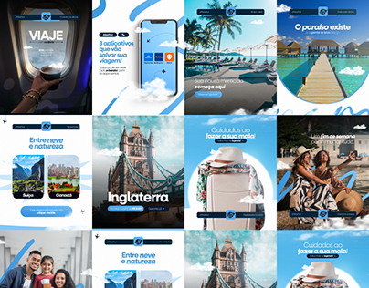

# Travel agency feed in sky blue with swooshes and circular crops

**Discipline:** print-social ·  · **Design style:** Photographic & Cinematic
**Tags:** instagram, feed, travel, blue, swoosh, circle-crop, photography, template-system

## What it is
A 4x3 grid of Instagram posts for a travel brand. Each uses full-bleed destination photos, a sky-blue brush swoosh, a small logo bar, and short headlines in white; some crop photos to circles or arches.

## What it means
Airy, aspirational and consistent; blue ties disparate destination photos together.

## Techniques
- Use one brush-stroke swoosh in the brand blue as a signature device across all posts.
- Alternate full-bleed photos with circular or arch crops for variety within a system.
- Keep headline size and placement predictable for scannability.
- Let a small cloud cutout blend photos with the sky palette.

## Best for
- Travel and tourism accounts
- Any brand needing a cohesive photo-led feed
- Templates for social managers

## Vocabulary
- **Feed grid** — The mosaic of posts on a profile page.
- **Brush swoosh** — A painted stroke used as a brand device.
- **Circle crop** — Photo masked into a circle.
- **Template system** — A set of layouts reused for consistency.
