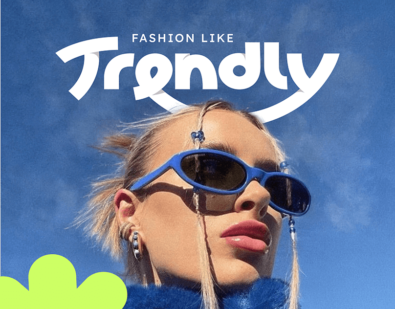

# Bubbly white script wordmark sweeping over a sunglasses selfie against blue sky, lime blob corner

**Discipline:** print-social ·  · **Design style:** Glassmorphism
**Tags:** fashion, wordmark, sky, blue-sunglasses, lime, script, selfie, cover

## What it is
A low-angle photo of a woman in blue wrap sunglasses and a blue fur collar under a deep blue sky. A thick white swash lettering 'Trendly' with a long underline curve crosses the top, small caps 'FASHION LIKE' above and a lime flower-shaped blob in the lower left.

## What it means
Fresh and fashionable; monochrome blue makes the lime blob and white logo pop.

## Techniques
- Colour-match wardrobe and background in one blue.
- Curve a thick wordmark with a swoosh under it.
- Add a single lime organic shape as accent.
- Shoot from below for attitude.

## Best for
- Fashion brand covers
- Photo-led brand launches
- Monochrome campaign visuals

## Vocabulary
- **Swash wordmark** — Lettering with long curving strokes.
- **Low-angle selfie** — A portrait taken from below.
- **Accent blob** — A small organic shape in a contrasting colour.
- **Monochrome photo** — An image dominated by one hue.
