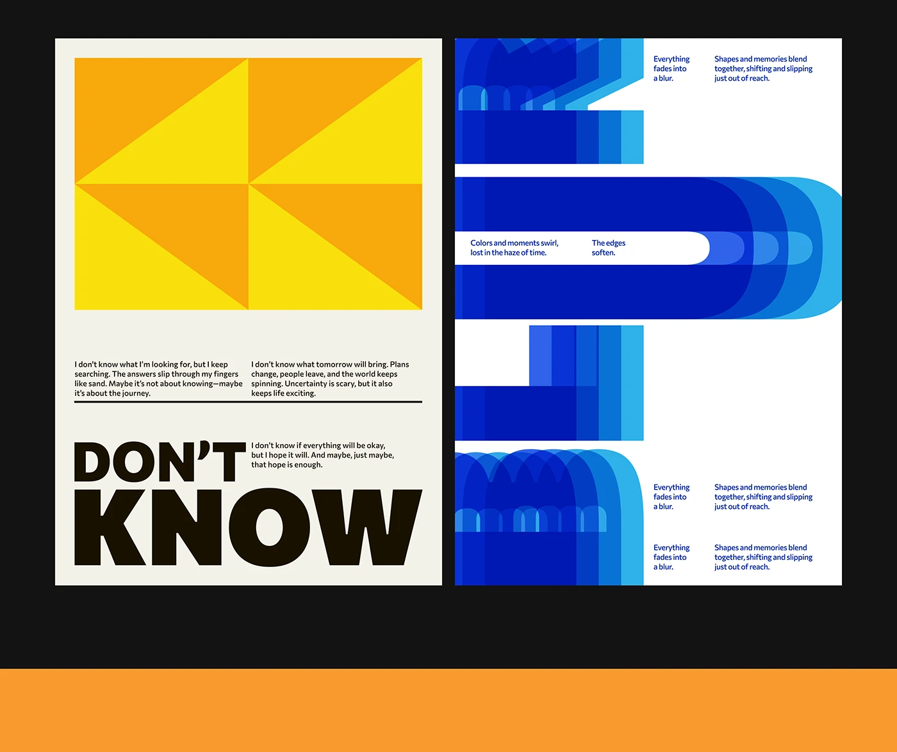

# Two posters: yellow-orange triangle tessellation over DON'T KNOW, and a blue echo-trail letter form

**Discipline:** print-social ·  · **Design style:** Playful & Illustrated
**Tags:** posters, yellow, orange, blue, tessellation, echo-effect, heavy-type, abstract

## What it is
Two posters on black. The left cream poster has a yellow and orange triangle pattern above two columns of small text and a heavy black 'DON'T KNOW'. The right white poster shows huge blue letters echoed in shifting blue tints, with small blue text blocks.

## What it means
Uncertain and playful; the pattern and the echo effect illustrate doubt and blur.

## Techniques
- Tile triangles in two warm colours.
- Repeat letters with offset tints to create motion echo.
- Use tiny two-column text as texture.
- Stay in a limited palette per poster.

## Best for
- Typography poster series
- Abstract concept posters
- Colour-limited graphics

## Vocabulary
- **Triangle tessellation** — A pattern of triangles filling a rectangle.
- **Echo effect** — Repeated shapes offset and shaded to imply motion.
- **Heavy stack** — A word set very bold across two lines.
- **Micro columns** — Small text columns used as texture.
