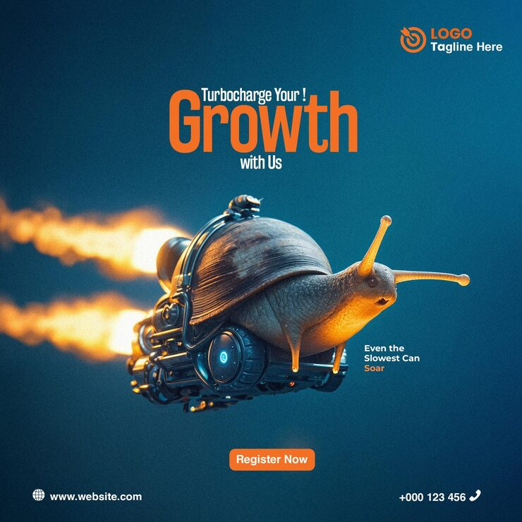

# 'Turbocharge Your Growth With Us' poster with a surreal jet-powered mechanical snail breathing fire

**Discipline:** print-social · **Design type:** Social ad · **Design style:** 3D & Surreal
**Tags:** growth, surreal, 3d-render, snail, fire, marketing

## What it is
A teal-gradient square poster with a photoreal 3D snail fitted with a jet-engine shell shooting orange fire trails, bold orange-and-white 'Turbocharge Your! Growth with Us' headline, the tagline 'Even the Slowest Can Soar', an orange 'Register Now' button and contact details.

## What it means
Witty and memorable; a slow animal turned rocket makes a growth-marketing cliché into a genuinely funny, shareable image.

## Techniques
- Combine an unexpected animal with a mechanical upgrade for humour.
- Ground the joke with a literal tagline explaining the visual pun.
- Render the hybrid subject photorealistically for maximum surprise.

## Best for
- Growth marketing campaigns
- Memorable ad concepts
- Surreal 3D advertising

## Vocabulary
- **Visual pun** — An image that literally illustrates an idiom or phrase.
- **Hybrid render** — A 3D object combining two unrelated forms.
