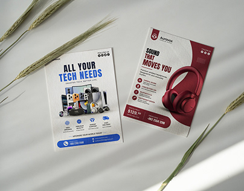

# Two A5 tech-product flyers, blue and burgundy, styled on pale linen with dried grass

**Discipline:** print-social ·  · **Design style:** Warm & Organic
**Tags:** flyer, product, blue, burgundy, mockup, electronics, linen, natural-props

## What it is
Two flyers lie on a beige surface with dried wheat stalks and sun shadows: a white and blue 'All your tech needs' sheet with a cluster of gadgets, and a burgundy and white 'Sound that moves you' sheet with a red headphone render, icon list and price.

## What it means
Clean and commercial; natural props soften electronics marketing.

## Techniques
- Show two flyers in different colourways together.
- Style with dried grass and sun shadows.
- Use a big product render on a curved white cut-out shape.
- Keep contact info in a coloured footer bar.

## Best for
- Retail and electronics flyers
- Print collateral mockups
- Small-business promotions

## Vocabulary
- **Colourway pair** — Two versions of a layout in different colours.
- **Curved cut-out** — A rounded white shape carved into a coloured panel.
- **Price badge** — A highlighted price label.
- **Natural styling** — Organic props used in a mockup.
