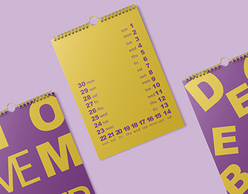

# Typographic wall calendar in purple and mustard with giant cropped month letters

**Discipline:** print-social · **Design type:** Typographic posters · **Design style:** Geometric & Bauhaus
**Tags:** calendar, typography, purple, mustard, print, spiral-bound

## What it is
Three spiral-bound wall calendars on lilac: a mustard page lists days of the month as a U-shaped column of numbers and weekday names in purple, flanked by purple pages with huge mustard cropped letters spelling 'NOVEMBER' and 'DECEMBER'.

## What it means
Graphic and witty; the dates become a shape and the month name becomes a pattern.

## Techniques
- Arrange dates along a path instead of a grid.
- Crop giant letters as a cover pattern.
- Stick to two complementary colours.

## Best for
- Calendars and planners
- Typographic print
- Stationery brands

## Vocabulary
- **Complementary colours** — Hues opposite on the colour wheel, like purple and yellow.
- **Path layout** — Text arranged along a line or shape.
