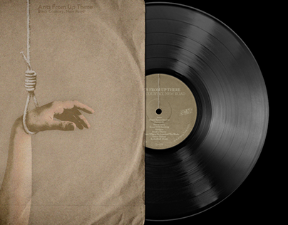

# Sepia record sleeve with a hand and rope, half-slid from its cover to reveal a black vinyl

**Discipline:** print-social · **Design type:** Music and event cover
**Tags:** album, vinyl, sepia, sleeve, black, mockup, moody, music

## What it is
A black background with a sepia paper-textured record sleeve showing an outstretched hand and a hanging rope, with small typography, and a black vinyl disc with a grey label pulled half out.

## What it means
Stark and haunting; sepia and black feel like an old archival release.

## Techniques
- Slide the record half out of the sleeve.
- Use a sepia paper-texture cover.
- Set small type at the top.
- Keep the background pure black.

## Best for
- Album and single covers
- Music mockups
- Moody dark presentation

## Vocabulary
- **Sleeve mockup** — A record cover shown with the disc.
- **Sepia tone** — A brown-toned monochrome.
- **Half reveal** — An object partly pulled out of its cover.
- **Paper texture** — Fibrous surface texture on a cover.
