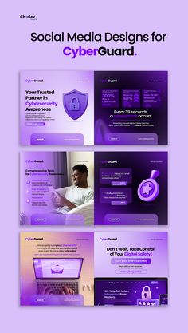

# Violet cybersecurity landscape posts with shield and lock 3D objects

**Discipline:** print-social ·  · **Design style:** 3D & Surreal
**Tags:** cybersecurity, violet, 3d-shield, landscape-cards, split-layout, portfolio-cover, dark-purple, photo

## What it is
A lavender portfolio cover headed 'Social Media Designs for CyberGuard' with three stacked wide cards in purple. Each is split between a text panel and a visual: a 3D shield, a person on a bed with a device, and a laptop with lock icons.

## What it means
Secure and modern; gradients and glossy objects feel protective yet friendly.

## Techniques
- Split wide cards into text and image halves.
- Use 3D glossy security icons as hero objects.
- Keep one purple gradient for the set.
- Present a cover in lighter lavender to contrast with dark cards.

## Best for
- Cybersecurity and tech services
- Landscape social cards
- Portfolio presentation covers

## Vocabulary
- **Split card** — A card divided into text and visual halves.
- **3D security icon** — A glossy rendered shield or lock.
- **Stacked cards** — Wide cards arranged vertically.
- **Tonal cover** — A lighter cover matching darker content.
