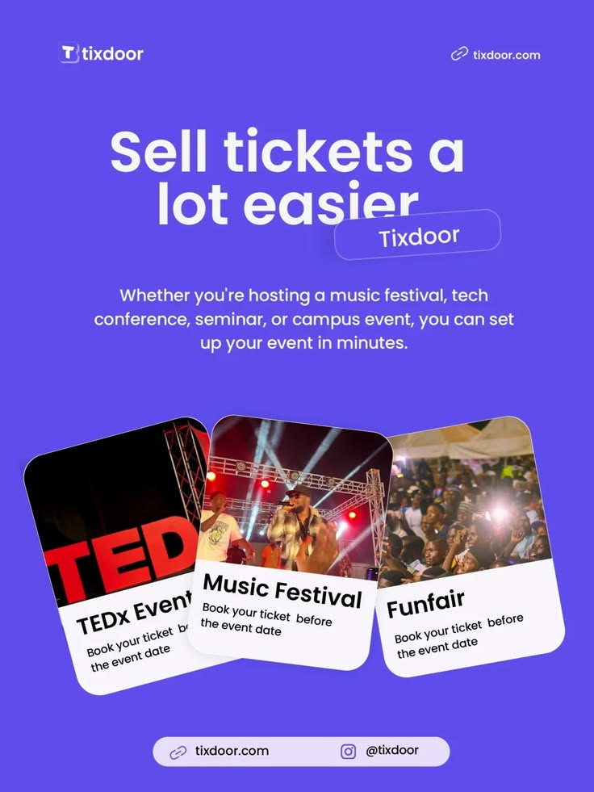

# Violet Ticketing Promo with Tilted Event Cards

**Discipline:** print-social ·  · **Design style:** Photographic & Cinematic
**Tags:** violet, events, tickets, tilted-cards, sans, portrait

## What it is
A saturated violet portrait promo with a big white headline, an overlapping tilted tag, body copy and three angled white photo cards for a conference, music festival and funfair, with a link pill at the foot.

## What it means
Loud color and playful tilts create an energetic, festival-like mood. The tilted cards imply variety and motion.

## Techniques
- Fan of rotated cards to imply a range of options
- Headline overlapped by a translucent label as a brand stamp
- Full-bleed single-color ground with white type for high contrast
- Photo top and text bottom card format repeated three times
- Footer pill combining web and social handles

## Best for
- Ticketing and event platforms
- Product announcements aimed at organisers
- Instagram portrait posts

## Vocabulary
- **Tilted card fan** — Cards rotated at slight angles and overlapped like a hand of playing cards.
- **Stamp label** — A small pill overlapping a headline to mark the brand.
- **Footer pill** — A rounded strip holding contact details.
