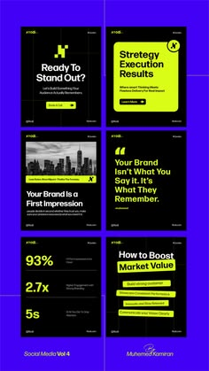

# Six electric-violet-framed black posts with lime highlight bars, big stats and quote card

**Discipline:** print-social ·  · **Design style:** Dark & Neon
**Tags:** marketing, templates, violet, lime, black, stats, quote, carousel

## What it is
A pin-size preview of six portrait posts on electric violet with black cards, lime highlight bars behind key phrases, a city photo card, a large quote mark, stacked stat numerals (93%, 2.7x, 5s) and a list of lime tags, captioned 'Social Media Vol 4'.

## What it means
Loud and confident; lime on black inside violet feels like a startup.

## Techniques
- Frame black cards with saturated violet.
- Highlight phrases with lime bars.
- Use stat cards in lime numerals.
- Add a big quote mark for testimonials.

## Best for
- Marketing and branding tips carousels
- Startup social systems
- Stat and quote cards

## Vocabulary
- **Violet frame** — A saturated border around dark cards.
- **Lime bar** — A highlight strip behind text.
- **Stat stack** — Numerals stacked in one card.
- **Volume label** — A caption numbering a template pack.
