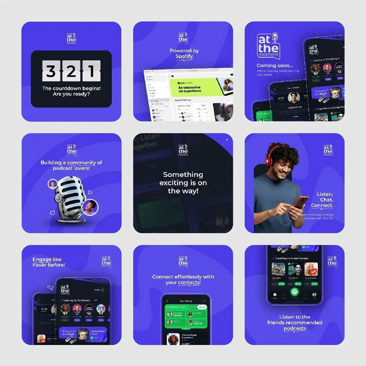

# Nine violet launch teaser posts with countdown, mic and dark phone screens

**Discipline:** print-social ·  · **Design style:** 3D & Surreal
**Tags:** launch, teaser, violet, countdown, podcast-app, phone-mockups, grid, 3d-microphone

## What it is
A 3x3 grid of square rounded posts on violet with a small logo at each top. They include a flip-clock countdown '3 2 1', a Spotify-powered UI, dark phone screens with green accents, a chrome 3D microphone with avatars, a portrait of a man with headphones and a black 'Something exciting is on the way!' card.

## What it means
Hype and community energy; violet plus dark screens feel like music and nightlife.

## Techniques
- Build teaser posts around a countdown clock graphic.
- Keep one background violet with wavy texture for all posts.
- Alternate device mockups with a hero object and a portrait.
- Use a single black post in the grid as a pause.

## Best for
- App launch teasers and countdowns
- Music and podcast products
- Coming-soon campaigns

## Vocabulary
- **Flip clock** — A countdown numeral style with split cards.
- **Teaser post** — A post hinting at a coming launch.
- **Wavy texture** — Subtle curved shapes in a background.
- **Pause card** — A darker post breaking the grid rhythm.
