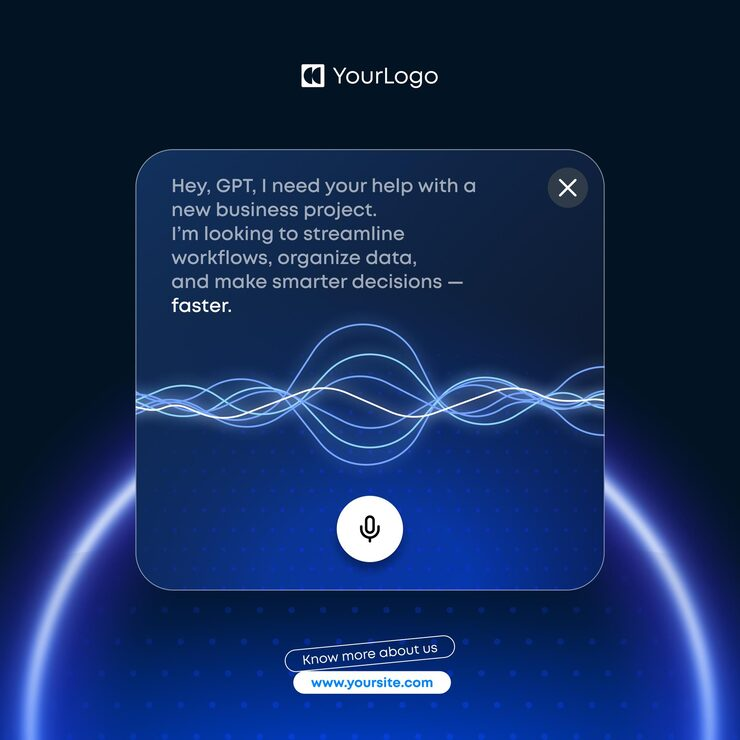

# Voice assistant prompt card with glowing blue sound waves, mic button and a planet-rim glow

**Discipline:** print-social · **Design type:** Product UI promo card · **Design style:** Glassmorphism
**Tags:** ai, voice, blue, glass, sound-wave, dark

## What it is
A square navy post with a logo, a frosted-glass rounded card containing a typed prompt ('Hey, GPT, I need your help with a new business project…' with 'faster.' in white), glowing interwoven blue sound waves, a white mic button and close X, over a bright blue planet-rim glow and dot grid, with two pill links below.

## What it means
Futuristic and conversational; the card reads as a live AI voice session.

## Techniques
- Show the product as a single glass UI card.
- Render voice as glowing interwoven waves.
- Set the card over a glowing planet horizon.
- Highlight the last word of the prompt.

## Best for
- AI assistant marketing
- Voice tech
- SaaS product posts

## Vocabulary
- **Waveform** — Lines showing sound amplitude.
- **Glass card** — A translucent blurred panel.
