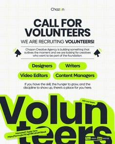

# Volunteer call in black with lime pills and giant cropped word

**Discipline:** print-social · **Design type:** Recruitment poster
**Tags:** recruitment, poster, black, lime, pills, giant-type, megaphone-icons, community

## What it is
A white poster with black bold headline 'Call for Volunteers', lime pill labels for roles (Designers, Writers, Video Editors, Content Managers) with megaphone icons, and a huge black word 'Volunteers' cropped at the bottom on a lime block.

## What it means
Energetic and inclusive; pill roles make it feel like choosing a badge, and the giant word closes the poster.

## Techniques
- Show open roles as lime pills.
- Crop a giant word at the bottom edge for scale and drama.
- Contrast black type with white and lime.
- Use small pointing icons to guide reading.

## Best for
- Volunteer and hiring drives
- Community and student organisations
- Announcement posters

## Vocabulary
- **Role pill** — A capsule naming a job or role.
- **Cropped word** — A word cut by the frame's edge.
- **Contrast pairing** — Black type against a neon highlight.
- **Call-to-action block** — A section prompting the reader to act.
