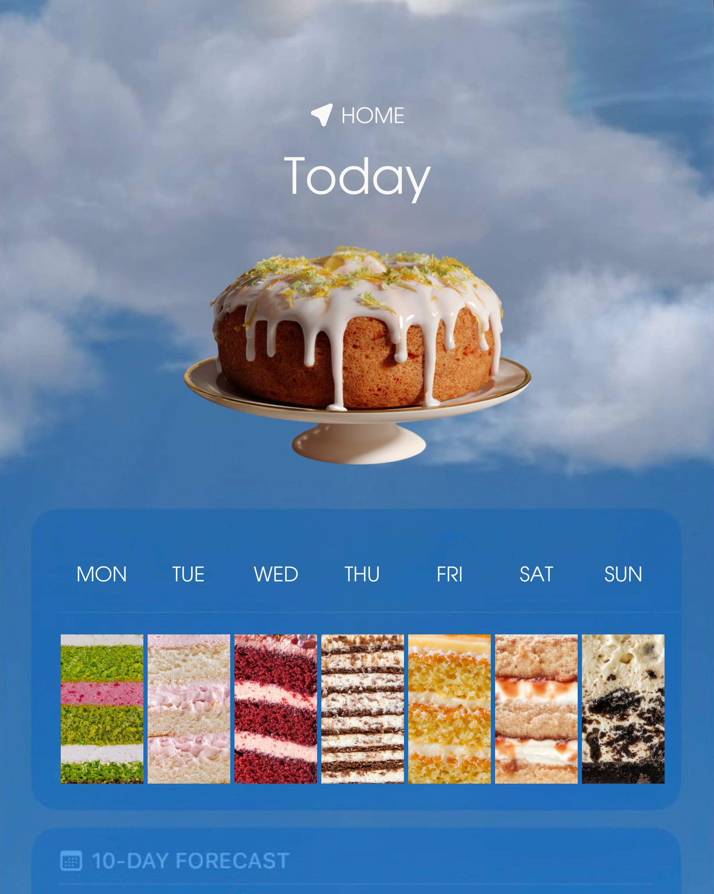

# Weather-app parody with a floating cake and a week of cake slices

**Discipline:** print-social ·  · **Design style:** 3D & Surreal
**Tags:** parody, weather-app, cake, sky, blue, surreal, forecast, food, interface-as-layout

## What it is
A portrait post that copies a weather app: a cloudy blue sky, 'HOME' and 'Today' at the top, a floating drizzle cake on a stand in place of the temperature, and a weekly forecast row where each day is a cross-section photo of a different cake. A '10-DAY FORECAST' bar peeks at the bottom.

## What it means
Witty and delicious; a familiar app frame makes a menu feel like something to check every day.

## Techniques
- Recreate a familiar app interface using product photography as the data.
- Replace icons with cake slices in a horizontal week strip.
- Float the hero product in the sky like a weather symbol.
- Keep the interface type thin and white for an authentic feel.

## Best for
- Food and bakery menus and daily specials
- Any brand able to parody a well-known interface
- Content series with day-by-day items

## Vocabulary
- **Interface parody** — Design that imitates an app to deliver a different message.
- **Week strip** — A row of seven items for days of the week.
- **Floating hero** — A product suspended in the middle of a scene.
- **Cross-section photo** — A close image showing layers inside a product.
