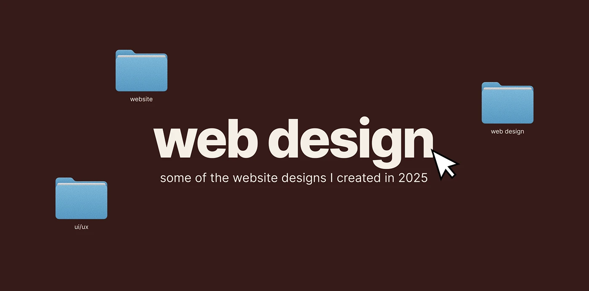

# Chocolate title slide with cream 'web design', cursor and three blue folders

**Discipline:** print-social · **Design type:** Presentation slides
**Tags:** title-slide, brown, cream, folders, cursor, desktop-metaphor, heavy-sans, portfolio

## What it is
A dark brown slide with a huge cream heavy sans 'web design', a pixel-outlined cursor at its end, a subline about 2025 designs and three blue folders labelled website, ui/ux and web design.

## What it means
Simple and consistent; a colour inversion of the social media title slide.

## Techniques
- Invert the palette of a series template.
- Scatter labelled folders.
- Use one cursor as an accent.
- Keep a subline small and light.

## Best for
- Portfolio section dividers
- Series with matching slides
- Desktop-themed decks

## Vocabulary
- **Palette inversion** — Swapping light and dark colours for a variant.
- **Section title slide** — A slide that names a portfolio section.
- **Folder scatter** — Folders placed around a title.
- **Cursor accent** — A pointer used as decoration.
