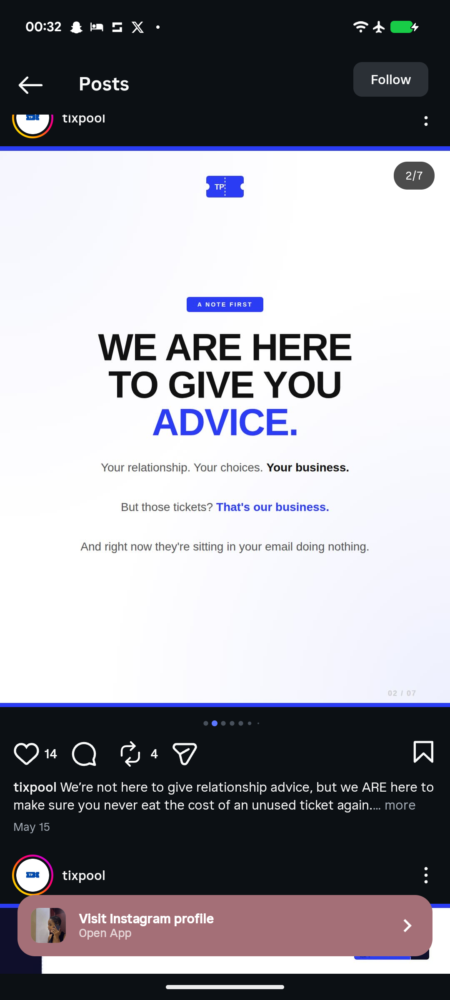

# We Are Here to Give You Advice Text Slide

**Discipline:** print-social · **Design type:** Social carousel
**Tags:** carousel, text-only, white, electric-blue, tag-pill, bold-caps, ticket-logo

## What it is
A white carousel slide with blue bars top and bottom, a ticket logo, a small blue tag 'A NOTE FIRST', a huge black heavy 'WE ARE HERE TO GIVE YOU' and a blue 'ADVICE.', and three short centred lines with bold key phrases.

## What it means
A single electric blue accent word in a black headline makes a text-only slide punchy, and plain lines below keep it conversational.

## Techniques
- One blue word in a black headline
- Small blue tag above the headline
- Bold key phrases inside light body lines
- Blue bars framing the slide
- Faint slide counter in a corner

## Best for
- Text-only carousel slides
- Brand voice posts
- Blue and white systems

## Vocabulary
- **Accent word** — A word set in a colour that differs from the headline.
- **Tag pill** — A small label above a heading.
- **Text-only slide** — A slide relying on type without images.
