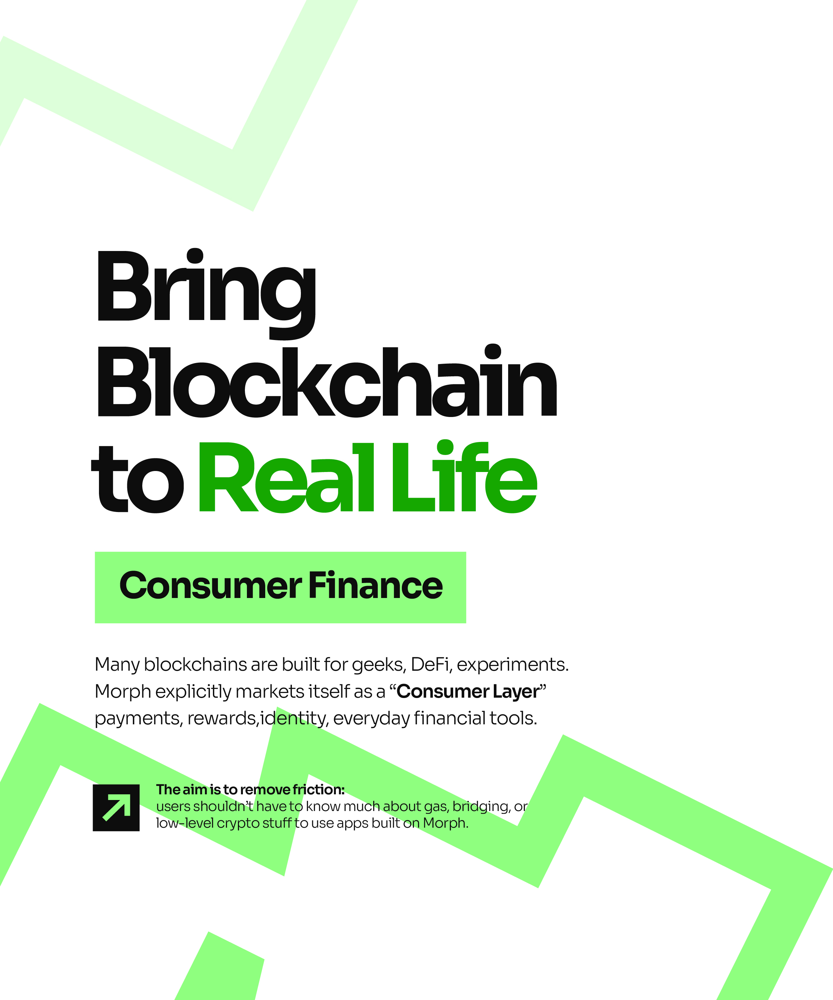

# Bring Blockchain to Real Life Zigzag Slide

**Discipline:** print-social · **Design type:** Social carousel
**Tags:** carousel, white, green, zigzag, heavy-sans, highlight, blockchain

## What it is
A white portrait slide with pale and bright green zigzag bands, a huge black 'Bring Blockchain to Real Life' heading with 'Real Life' in green, a mint highlight bar 'Consumer Finance', a paragraph and a black arrow tile with a note about removing friction.

## What it means
Bold tightly set type with jagged green lines feels energetic like a rising chart, and the mint bar labels the topic.

## Techniques
- Zigzag bands that suggest a chart line
- Huge tight heavy headline
- Green accent on key words
- Mint highlight bar behind a label
- Arrow tile with a short note

## Best for
- Crypto and fintech carousels
- Bold type-led explainer slides
- Green and black brand systems

## Vocabulary
- **Zigzag band** — A thick angular stroke suggesting movement or growth.
- **Highlight bar** — A solid rectangle behind a label.
- **Arrow tile** — A square tile containing a directional arrow.
