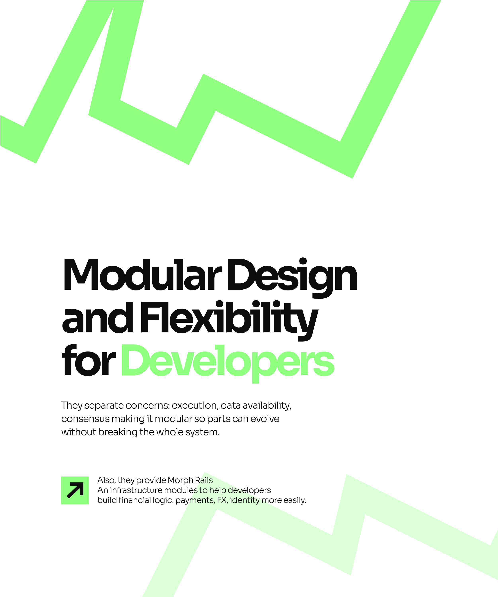

# Modular Design for Developers Zigzag Slide

**Discipline:** print-social ·  · **Design style:** Geometric & Bauhaus
**Tags:** carousel, white, mint, zigzag, heavy-sans, developers, arrow-tile

## What it is
A white portrait slide with a bright mint zigzag band at the top and a pale one at the base, a big black tightly set heading 'Modular Design and Flexibility for Developers' with 'Developers' in mint, a paragraph and an arrow tile with an extra note.

## What it means
The same zigzag system in a lighter arrangement keeps the series consistent while changing the mood.

## Techniques
- Zigzag band cropped at the top edge
- Tight heavy headline with a mint accent word
- Paragraph and arrow-tile note under it
- Pale ghost zigzag at the base
- Series consistency across four slides

## Best for
- Developer-facing carousels
- Series with a repeated graphic motif
- White and mint minimal type slides

## Vocabulary
- **Series motif** — A graphic repeated across slides to unify them.
- **Ghost band** — A very pale version of a graphic used as a background.
- **Tight leading** — Very small spacing between lines of a headline.
