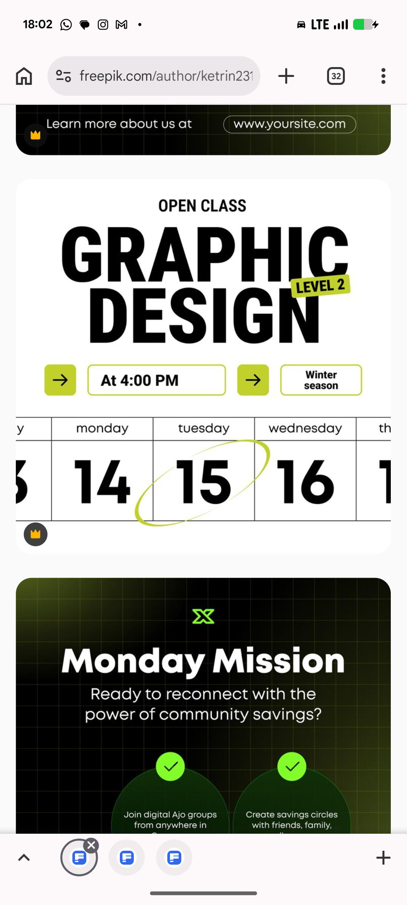

# Graphic Design Open Class with Calendar Strip

**Discipline:** print-social ·  · **Design style:** Dark & Neon
**Tags:** class, announcement, white, black, lime, calendar, condensed, vector

## What it is
A white square post with a small OPEN CLASS label, a huge black condensed 'GRAPHIC DESIGN' with a tilted lime LEVEL 2 tag, a row of lime arrow buttons and outlined boxes reading 'At 4:00 PM' and 'Winter season', and a weekday strip of huge numerals 14, 15, 16 with a lime ellipse around the 15; below it the top of a dark green Monday Mission post with a grid and tick circles.

## What it means
Massive condensed type and a circled date give a class announcement instant clarity.

## Techniques
- Huge condensed caps headline
- Tilted tag overlapping the headline
- Weekday table with the target date circled
- Lime arrow squares as connectors
- Outlined info boxes

## Best for
- Course and workshop announcements
- Schedule posts
- Bold black and white with one accent

## Vocabulary
- **Circled date** — A date marked with a hand-drawn ellipse.
- **Condensed type** — Narrow letterforms allowing very large headlines.
- **Info box** — An outlined rectangle holding a time or place.
