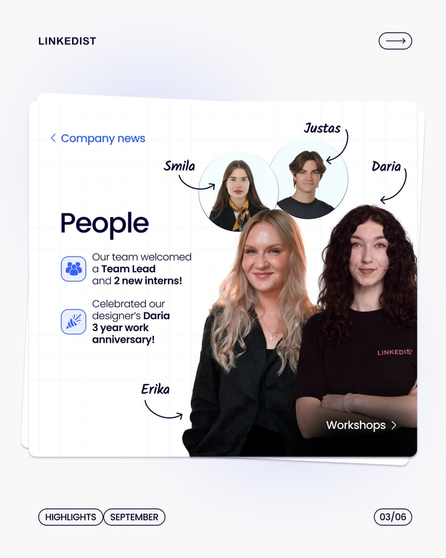

# People News Slide with Cut-Out Team Photos

**Discipline:** print-social ·  · **Design style:** Photographic & Cinematic
**Tags:** carousel, white, grid-paper, cutouts, script-labels, arrows, team

## What it is
A portrait carousel slide on a stacked grid-paper card with a blue 'Company news' back link, a large 'People' heading, two icon bullets about new hires and an anniversary, cut-out portraits of team members and small circle portraits with handwritten names and curved arrows, and a Workshops link.

## What it means
Cut-out people with handwritten labels make company news feel personal and lively.

## Techniques
- Cut-out photos overlapping the card edge
- Handwritten names with curved arrows
- Circle portraits and large bust portraits mixed
- Icon bullets in blue tiles
- Series chrome with slide counter and tags

## Best for
- Company news and HR carousels
- Team announcements
- Series-based LinkedIn content

## Vocabulary
- **Cut-out portrait** — A person masked from their background.
- **Handwritten label** — A script-style name with a hand-drawn arrow.
- **Series chrome** — Repeated header and footer elements across slides.
