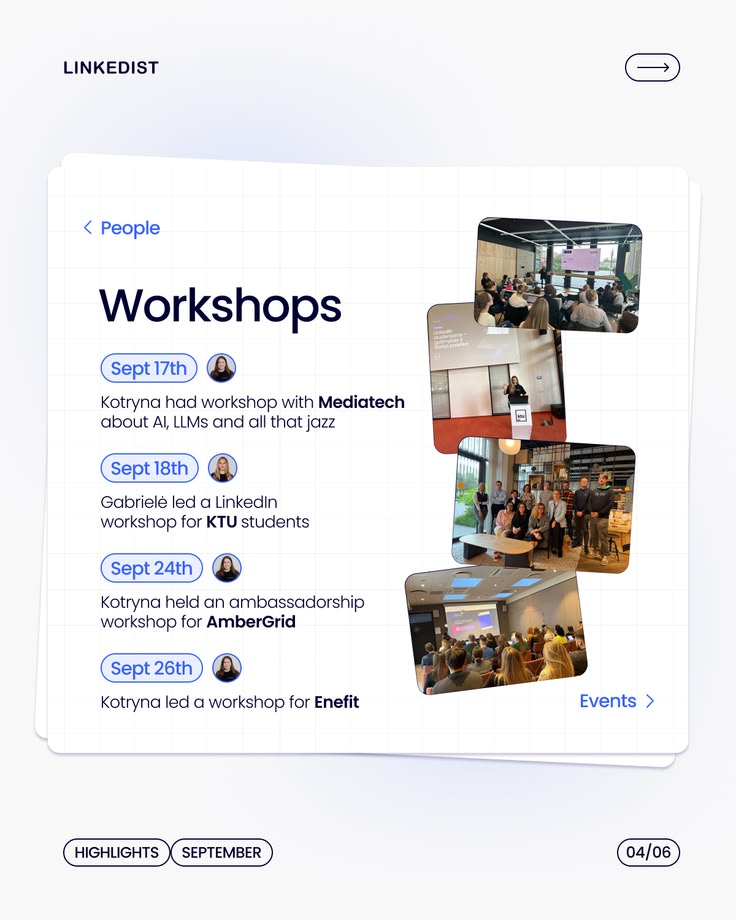

# Workshops List Slide with Photo Stack

**Discipline:** print-social · **Design type:** Social carousel
**Tags:** carousel, white, blue-pills, photos, dates, list, portrait

## What it is
A portrait carousel slide listing four workshops with date pills and small avatars, plus a diagonal stack of rounded event photos at right, on the same grid-paper card series.

## What it means
Date pills and avatars make a list scannable and personal, and real photos add credibility.

## Techniques
- Outlined blue pill for each date
- Avatar next to every item to show who
- Bold organisation names inside light copy
- Rounded photos staggered along the right edge
- Consistent header and footer chrome across the series

## Best for
- Event roundups
- Team activity recaps
- Series-based LinkedIn content

## Vocabulary
- **Date pill** — A rounded outlined chip containing a date.
- **Photo stack** — A cascade of overlapping rounded photos.
- **Series chrome** — Repeated header and footer elements that unify slides.
