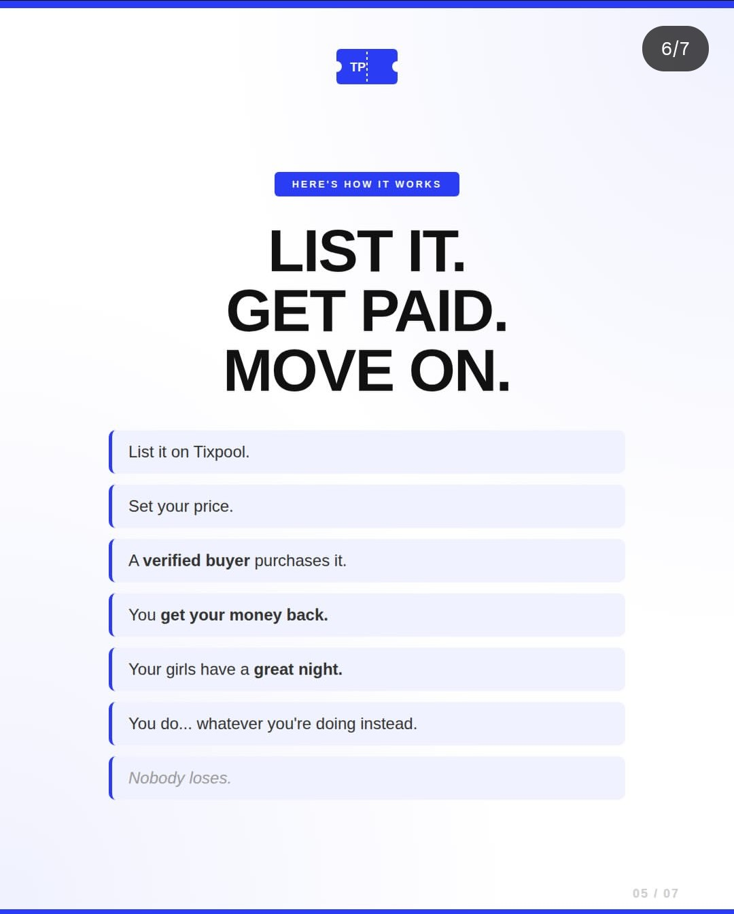

# List It, Get Paid, Move On (Full Frame)

**Discipline:** print-social · **Design type:** Social carousel
**Tags:** carousel, how-it-works, white, blue-rules, steps, full-frame, ticket-logo

## What it is
The full-frame version of the steps slide: a ticket logo, a 6/7 counter, a blue tag, a three-line black headline and seven pale rounded rows with blue left rules, and a faint 05/07 page mark.

## What it means
The clean grid of same-height rows makes each step equally weighted, and there is nothing else on the slide to distract.

## Techniques
- Equal-height rows for steps
- Blue left borders as bullets
- Centred stack with wide margins
- Bold emphasis on outcomes
- Faint page counter in the corner

## Best for
- Step-by-step carousel slides
- Marketplace explainers
- Minimal white slides

## Vocabulary
- **Equal-weight list** — A list where every item has the same visual size.
- **Page mark** — A faint numbering in the corner of a slide.
- **Full-frame capture** — An image showing the whole slide without device chrome.
