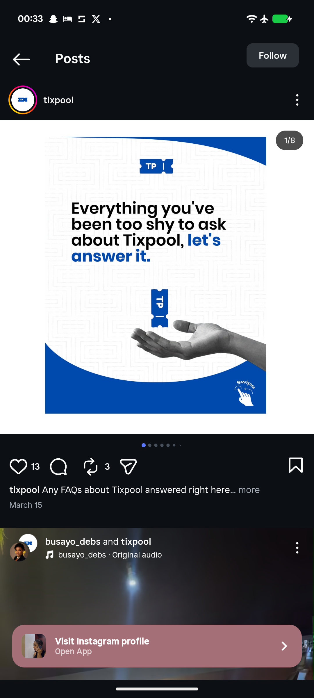

# FAQ Cover with Hand Holding a Blue Ticket

**Discipline:** print-social · **Design type:** Social carousel cover
**Tags:** carousel, cover, faq, maze-pattern, hand, blue-ticket, curved-bands, black-white-photo

## What it is
A white cover with a faint maze pattern, blue curved bands at the top right and the bottom, a ticket logo, a heavy headline 'Everything you've been too shy to ask about Tixpool, let's answer it.' with the last words in blue, a monochrome hand offering a blue vertical ticket and a swipe hint.

## What it means
A grey hand presenting a blue ticket keeps the focus on one colourful object, and the curved bands cradle it like a bowl.

## Techniques
- Black-and-white hand with one blue object
- Curved blue bands as a frame
- Blue emphasis on the last words
- Faint brand pattern behind
- Swipe hint in the corner

## Best for
- FAQ and explainer carousel covers
- Offer-a-thing photography
- Blue and white brand systems

## Vocabulary
- **Offering hand** — A hand presenting an object to the viewer.
- **Curved band** — A wide curved stripe used to frame content.
- **Selective colour** — Keeping a photo monochrome except for one coloured element.
