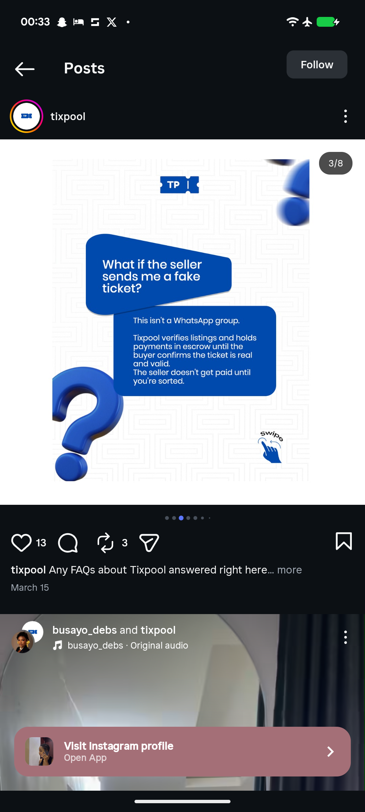

# FAQ Slide with 3D Question Mark and Chat Bubbles

**Discipline:** print-social ·  · **Design style:** 3D & Surreal
**Tags:** carousel, faq, white, maze-pattern, 3d, blue, chat-bubbles, swipe

## What it is
A white slide covered in a faint maze-like line pattern with a ticket logo, a chunky glossy 3D blue question mark at the lower left, a tilted blue speech card with the question 'What if the seller sends me a fake ticket?', a blue answer card with escrow explanation and a hand-drawn swipe hint at the corner.

## What it means
Question and answer as chat bubbles make an FAQ feel like a conversation, and the 3D question mark is a clear symbol.

## Techniques
- Question and answer as two speech cards
- Glossy 3D question mark as a hero object
- Faint maze pattern as a brand texture
- Blue and white only
- Hand-drawn swipe cue

## Best for
- FAQ carousel slides
- Trust and safety explanations
- 3D icon accents

## Vocabulary
- **Speech card** — A card shaped like a chat bubble.
- **Brand pattern** — A repeated faint pattern unique to a brand.
- **Swipe hint** — A small illustrated cue to move to the next slide.
