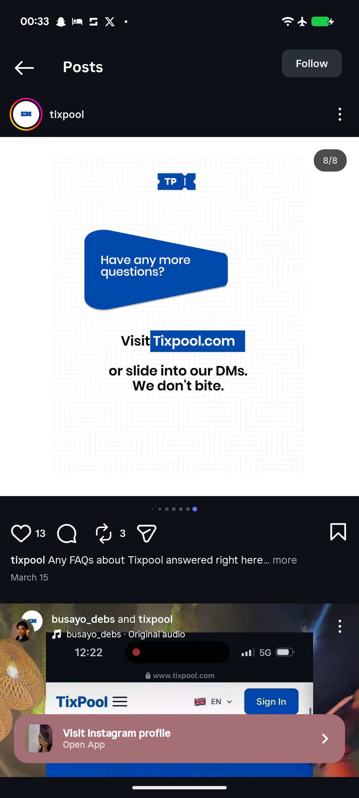

# Have Any More Questions Closing Slide

**Discipline:** print-social · **Design type:** Social carousel
**Tags:** carousel, closing, faq, maze-pattern, blue-card, highlight, dm-cta

## What it is
A white slide with a faint maze pattern, a ticket logo, a tilted blue speech card with 'Have any more questions?' and below it black type 'Visit Tixpool.com' with the URL on a blue highlight block and 'or slide into our DMs. We don't bite.'

## What it means
A playful, human ending with a blue highlight on the URL makes the call to action easy to spot.

## Techniques
- Speech card as the question
- URL on a solid blue highlight block
- Friendly closing line
- Faint pattern background
- Centred layout with generous space

## Best for
- Closing slides for FAQ carousels
- Friendly CTAs
- Blue highlight emphasis

## Vocabulary
- **Highlight block** — A solid rectangle behind key words.
- **DM call to action** — An invitation to send a direct message.
- **Friendly closer** — A last line with an informal tone.
