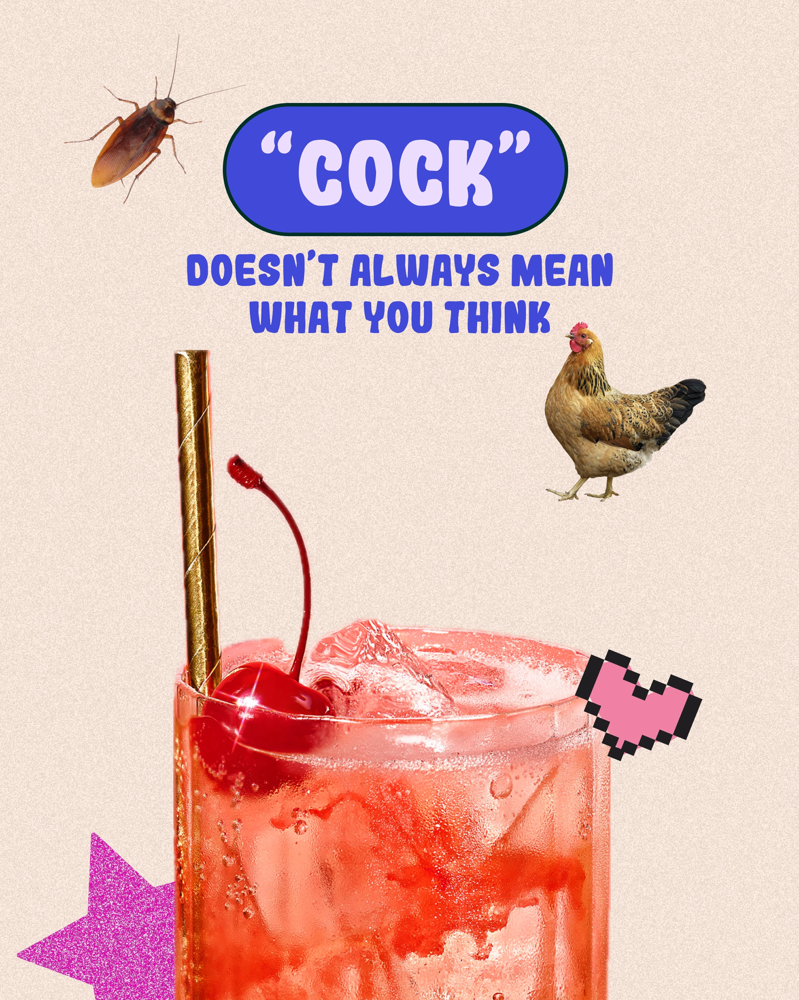

# Word-play post with cutout animals and a cherry cocktail

**Discipline:** print-social · **Design type:** Social educational post
**Tags:** social-media, education, collage, cutout, bubble-type, cream, cocktail, humour

## What it is
A 4:5 cream post with grainy texture. A royal-blue pill holds the quoted word, a two-line blue caption follows, and cut-out photos of a cockroach, a hen and a glossy cherry cocktail form a collage, with a pixel heart and glittery magenta star.

## What it means
Witty and irreverent; the surreal mix of animals and drink teases the double meaning.

## Techniques
- Illustrate a pun with unexpected cut-out objects that each hint at a meaning.
- Contrast grainy paper-like background with glossy hi-res photos.
- Anchor the message with one saturated blue pill and matching caption.
- Sprinkle small pixel and glitter stickers for playfulness.

## Best for
- Language and education creators
- Humour-driven social posts
- Editorial-style campaigns

## Vocabulary
- **Cutout collage** — Composition of background-removed photos.
- **Grain texture** — Fine noise added for a paper or print feel.
- **Pun visual** — An image built to illustrate a double meaning.
- **Glitter sticker** — A sparkling shape used as accent.
