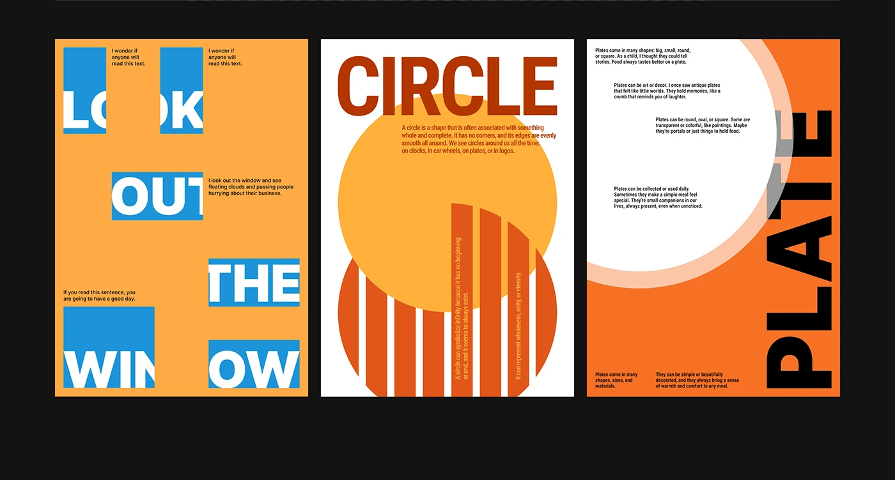

# Three word-play posters in orange, blue and cream with cropped type in boxes

**Discipline:** print-social ·  · **Design style:** Geometric & Bauhaus
**Tags:** posters, typography, orange, blue, word-image, cropped-type, circle, stripes

## What it is
Three portrait posters on black. One is orange with 'LOOK OUT THE WINDOW' broken into words inside blue boxes that crop the letters; one is white with 'CIRCLE' and an orange disc with stripe cut-outs; one is orange with a big white circle and 'PLATE' set vertically in black.

## What it means
Playful and clever; layouts act out the word.

## Techniques
- Place each word in its own coloured box that crops the letters.
- Draw the named shape (circle, plate) as the main image.
- Rotate a title vertically along the edge.
- Tuck small text into gaps as a texture.

## Best for
- Typographic series and experiments
- Editorial posters
- Design-school and portfolio work

## Vocabulary
- **Letter crop** — Cutting letters at a box edge so they are partly hidden.
- **Word-shape mapping** — Drawing the shape a word describes.
- **Vertical title** — Text rotated to run up the side.
- **Micro paragraph** — Small blocks of text used as texture.
