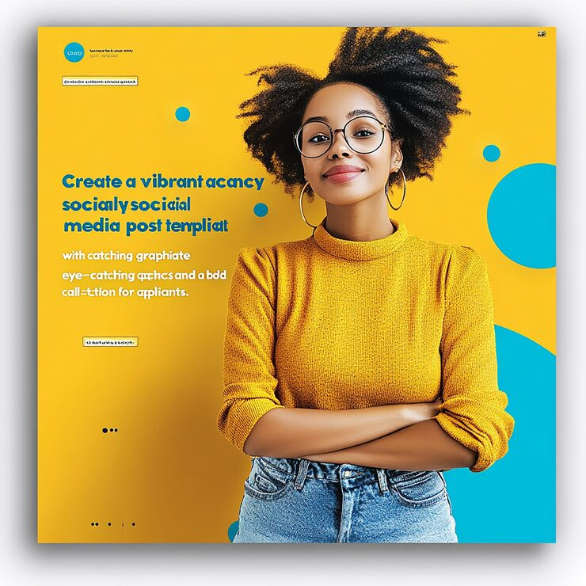

# Yellow agency post with a confident woman in glasses and cyan circles (AI-generated, garbled text)

**Discipline:** print-social · **Design type:** Social ad · **Design style:** Photographic & Cinematic
**Tags:** agency, yellow, cyan, portrait, circles, ai-generated

## What it is
A square mustard-yellow post with a smiling woman in round glasses, hoop earrings and a mustard turtleneck with arms crossed, cyan circles of various sizes, a blue headline and small label boxes; the copy is AI-generated and illegible ('vibrant acancy socialy socicial').

## What it means
Warm and confident; outfit matching the background makes the subject feel part of the brand — but the garbled text shows why AI mockups need real typesetting.

## Techniques
- Match the model's outfit to the background colour.
- Add a complementary colour through simple circles.
- Pose the subject with crossed arms for confidence.

## Best for
- Mood reference for colour-matched portraits
- Agency recruitment ads
- Youthful brand campaigns

## Vocabulary
- **Colour matching** — Coordinating clothing and background colour.
- **Complementary accent** — A contrasting hue used sparingly.
