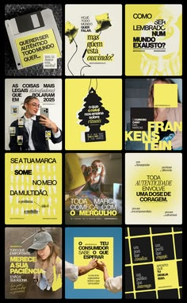

# Yellow, black and white post mosaic with floppy disk, stickers, cutouts and stacked bold headlines

**Discipline:** print-social ·  · **Design style:** Photographic & Cinematic
**Tags:** brand-strategy, yellow, black, white, stickers, floppy-disk, cutouts, portuguese

## What it is
A pin preview of twelve portrait posts in yellow, black and photo: a floppy disk label, a hanging air-freshener tree, portrait cutouts with yellow rectangles, and bold stacked headlines like 'Se a sua marca some no meio da multidão' with yellow highlight blocks and grid shapes.

## What it means
Bold and irreverent; yellow blocks over black-and-white photos feel like marketing zine pages.

## Techniques
- Put yellow rectangles over photos as text holders.
- Use quirky retro objects (floppy disk, air freshener).
- Stack heavy headlines with keyword highlights.
- Keep a yellow, black and white palette.

## Best for
- Marketing and branding creators
- Yellow-black social systems
- Zine-style carousels

## Vocabulary
- **Yellow text holder** — A yellow rectangle behind text over a photo.
- **Retro object post** — A post starring an old-tech object.
- **Keyword highlight** — A coloured block behind key words.
- **Post mosaic** — A grid overview of posts.
