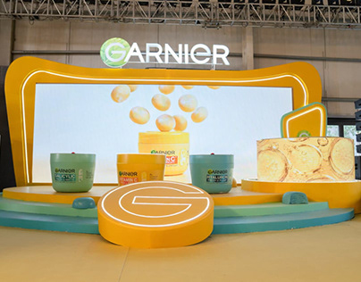

# Yellow product-launch stage with a rounded LED frame, terraced platforms and giant logo disc

**Discipline:** print-social · **Design type:** Event key visual
**Tags:** event, stage, yellow, rounded-frame, led-screen, 3d-render, brand-activation, beauty

## What it is
A render of a stage set in yellow: a big rounded frame around an LED wall showing floating orange capsules, three pots on stepped teal and yellow platforms, a glowing logo disc in front and a fruit-slice cube at the right.

## What it means
Sunny and fresh; the fruit-yellow world makes a beauty product feel joyous.

## Techniques
- Wrap a screen in a chunky rounded frame.
- Build stepped platforms for products.
- Use a round glowing logo as a stage centre.
- Keep the set in brand yellow with teal accents.

## Best for
- Brand activations and pop-ups
- Beauty and FMCG launches
- Booth and stage design

## Vocabulary
- **Stepped platforms** — Tiered display bases for products.
- **Rounded LED frame** — A soft-cornered frame around a screen.
- **Brand-colour world** — A set built in the brand colours.
- **Logo disc** — A circular podium carrying a logo.
