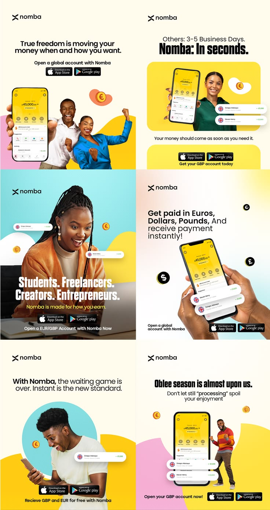

# Yellow and Cream Fintech Ad Grid

**Discipline:** print-social · **Design type:** Social ad set
**Tags:** fintech, yellow, cream, ads, portraits, store-badges, organic-shapes, africa

## What it is
A six-panel grid of square-ish social ads for a global account app: cream and yellow backgrounds with blob shapes, confident portraits of people holding or using the yellow app, floating transfer cards, coin icons and store badges.

## What it means
Warm yellow, joyful people and playful shapes make money movement feel optimistic and fast.

## Techniques
- Yellow app screens repeated so the product colour equals the brand colour
- Organic blobs in yellow, pink and blue behind subjects
- Floating transaction pills overlapping the photos
- Headline mixing a light setup line and a heavy punch line
- Store badges anchoring the bottom of every ad

## Best for
- Fintech app install campaigns
- Consistent multi-ad social sets
- Diaspora and youth audiences

## Vocabulary
- **Blob shape** — An organic rounded shape used behind subjects.
- **Floating card** — A UI card overlaid on a photo.
- **Setup and punch line** — A light lead-in line followed by a bold payoff.
